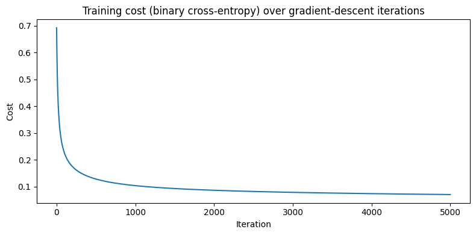
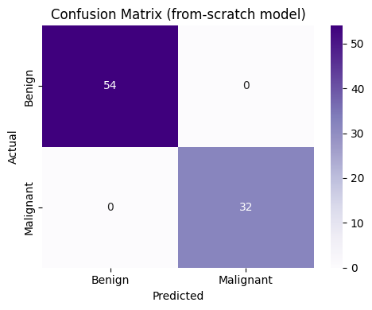

# Breast Cancer Diagnosis with Logistic Regression from Scratch

Classifies breast tumours as **malignant or benign** from measurements of cell nuclei, using the Breast Cancer Wisconsin (Diagnostic) dataset. Logistic Regression is **implemented from scratch with NumPy** and trained by gradient descent. scikit-learn's version is trained alongside it as a reference.

> **Not medical advice.** This is a learning project. Its predictions must not be used to diagnose anyone; diagnosis requires a qualified medical professional.

## What it does

1. Loads the Wisconsin data (`data.csv`, 569 tumours) and drops the `id` column and the empty `Unnamed: 32` column.
2. Encodes the diagnosis: malignant (`M`) = 1, benign (`B`) = 0. About 37% of tumours are malignant.
3. Uses 30 features: ten nucleus measurements (radius, texture, perimeter, area, smoothness, compactness, concavity, concave points, symmetry, fractal dimension), each as a mean, standard error and "worst" value.
4. Splits the data into 85% training and 15% test, **stratified** so both keep the same malignant/benign ratio.
5. **Min-max scales** the features to 0–1, using the training set's minimum and maximum only.
6. Trains the **from-scratch Logistic Regression** with batch gradient descent, printing the cost every 500 iterations.
7. Trains scikit-learn's `LogisticRegression` on the same data to check the implementation.
8. Compares both on training and test accuracy, **malignant recall** and ROC AUC, against an "always predict benign" baseline. Prints a classification report.
9. Plots the training cost curve and a confusion matrix.

## Concepts covered

- **Logistic Regression from first principles** — the model computes `z = w·x + b` for each tumour and passes it through the **sigmoid** function, `1 / (1 + e^(-z))`. That gives a probability of malignancy between 0 and 1; 0.5 or above is classified as malignant.
- **Binary cross-entropy cost** — measures how far the predicted probabilities are from the true labels. Confident wrong answers are penalized heavily. Probabilities are clipped away from exactly 0 and 1 so `log(0)` can never occur.
- **Gradient descent** — each iteration computes the gradient of the cost with respect to the weights and bias (`Xᵀ(p − y) / m` and the mean of `p − y`). It then steps the parameters a little in the opposite direction. The learning rate sets the size of each step.
- **Vectorization** — the whole training set is processed with matrix operations (`X @ w`), with no Python loop over samples. That is far faster and closer to how real libraries work.
- **Learning rate and convergence** — too small a learning rate, or too few iterations, leaves the model **under-trained**: the cost is still falling when training stops. The cost curve makes this easy to spot. A flattening curve means the model has converged.
- **Checking your own implementation** — training scikit-learn's `LogisticRegression` on the same data gives a trusted reference. If the from-scratch model lands in the same range, the maths is very likely right.
- **Scaling without leakage** — the min and max used for scaling come from the training set only. The test set is scaled with those same numbers, as new patients would be.
- **Recall for the malignant class** — in cancer screening, missing a malignant tumour (a false negative) is far more serious than a false alarm. Malignant recall, the share of malignant tumours correctly flagged, matters more than overall accuracy.

## Project structure

```
main.py      # full pipeline, organized into functions (config, loading,
              # stratified split, leakage-free scaling, LogisticRegressionGD class,
              # scikit-learn reference, evaluation, plotting)
README.md    # this file
```

The code is organized into small, named pieces driven by a `PipelineConfig` dataclass. The from-scratch model is the `LogisticRegressionGD` class, with `fit`, `predict_proba` and `predict` like a scikit-learn model. The supporting functions are `sigmoid`, `load_data`, `split_data`, `min_max_scale`, `evaluate`, `plot_cost_curve` and `plot_confusion_matrix`. `run_pipeline()` runs them in order.

Settings such as the learning rate, number of iterations and test size live in `PipelineConfig`. That makes it easy to see the effect of training for too short a time:

```python
from main import PipelineConfig, run_pipeline

run_pipeline(PipelineConfig(learning_rate=0.01, num_iterations=1000))   # the original, under-trained settings
```

## Requirements

```
numpy
pandas
matplotlib
seaborn
scikit-learn
```

Install with:

```bash
pip install numpy pandas matplotlib seaborn scikit-learn
```

## How to run

Download `data.csv` from the [Kaggle Breast Cancer Wisconsin (Diagnostic) dataset](https://www.kaggle.com/datasets/uciml/breast-cancer-wisconsin-data), place it in the same directory as `main.py`, then:

```bash
python main.py
```

## Sample output

Running the script prints the dataset summary, the training cost every 500 iterations, a comparison table of the two models with the baseline, and a classification report, then displays the cost curve and a confusion matrix.

**Training cost**



**Confusion matrix**


**Results (86 test tumours)**

| Setup | Train accuracy | Test accuracy | Malignant recall |
|-------|---------------:|--------------:|-----------------:|
| Original settings (learning rate 0.01, 1,000 iterations) | 90.68% | 88.37% | – |
| **From scratch, fixed (learning rate 1.0, 5,000 iterations)** | 98.14% | **100.00%** | **1.000** |
| scikit-learn `LogisticRegression` (reference) | 96.89% | 98.84% | 0.969 |
| Always predict "benign" | – | 62.79% | 0.000 |

**10-fold cross-validation** (from-scratch model): **97.37% ± 1.62%** accuracy, malignant recall 0.948.

## A note on the results

The original notebook reached 88.4% test accuracy because the model **stopped training too early**. With a learning rate of 0.01 and 1,000 iterations, the cost had only fallen from 0.69 to about 0.52 and was still dropping steadily. Raising the learning rate to 1.0 and training for 5,000 iterations brings the cost down to about 0.07. Test accuracy rises to the level scikit-learn reaches, which confirms the from-scratch implementation is correct.

The 100% test score should be read with care. The test set is only 86 tumours, so one split can easily be lucky. Ten-fold cross-validation gives the more realistic figure: about **97% accuracy, catching about 95% of malignant tumours**. That is very good, but it still means roughly one malignant tumour in twenty would be missed. That is a reminder of why models like this support, rather than replace, medical diagnosis.

Other changes from the original:
- the min-max scaling now uses training-set statistics only;
- the split is stratified;
- `print(data.head)` (which printed the method instead of the table) is fixed;
- the random weight initialization is seeded;
- a `log(0)` guard was added;
- the prediction loop is vectorized.

Natural next steps would be:

- adding L2 regularization to the from-scratch model;
- lowering the decision threshold to catch more malignant tumours;
- implementing mini-batch or stochastic gradient descent.

## References

- [UCI Machine Learning Repository — Breast Cancer Wisconsin (Diagnostic)](https://archive.ics.uci.edu/dataset/17/breast+cancer+wisconsin+diagnostic)
- [Kaggle — Breast Cancer Wisconsin (Diagnostic) Data Set](https://www.kaggle.com/datasets/uciml/breast-cancer-wisconsin-data)
- [scikit-learn — LogisticRegression](https://scikit-learn.org/stable/modules/generated/sklearn.linear_model.LogisticRegression.html)
- [GeeksforGeeks — Machine Learning Projects](https://www.geeksforgeeks.org/machine-learning/machine-learning-projects/), used as a general reference/inspiration while working on this project.

---
*This is a personal learning project. It is not a medical device and must not be used for diagnosis.*
