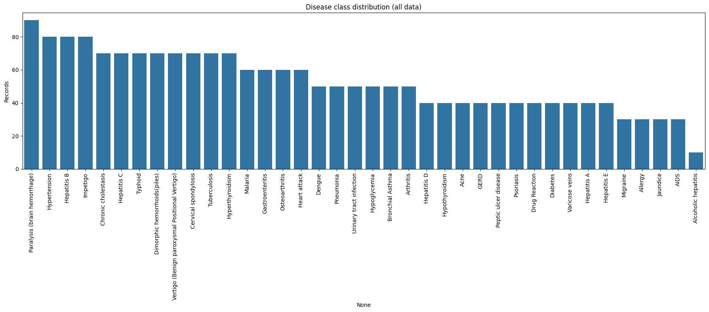
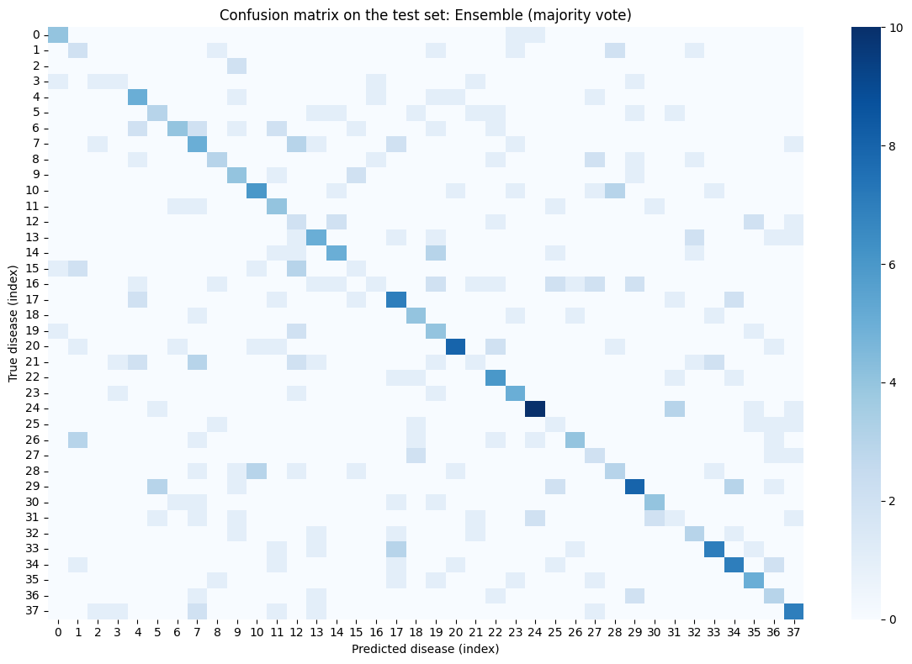

# Disease Prediction from Symptoms

Predicts a **disease from a list of symptoms** using machine learning. Each patient record is a set of yes/no symptom indicators (fever, headache, skin rash…). Four classifiers (Decision Tree, Random Forest, SVM and Naive Bayes) are compared, and three of them are combined in a **majority-vote ensemble**.

> **Not medical advice.** This is a learning project trained on a small, noisy dataset. Its predictions are often wrong and must never be used to diagnose or treat anyone. Anyone with symptoms should see a qualified healthcare professional.

## What it does

1. Loads the symptom dataset (`improved_disease_dataset.csv`): one row per patient, one 0/1 column per symptom, and a `disease` label.
2. Encodes the disease names as numbers, and any text columns (such as gender) as numbers too. Missing symptom values count as absent.
3. Plots how many records each disease has.
4. Holds out a **stratified 20% test set** that is never oversampled and never used for training.
5. Runs **5-fold cross-validation** on the training set for all four models. Random oversampling happens *inside* each fold, so duplicated rows never leak into the validation part.
6. Oversamples the training set so every disease is equally represented, then trains the four final models.
7. Builds a **majority-vote ensemble** of Random Forest, Naive Bayes and SVM. When all three disagree, the model with the best cross-validation score decides.
8. Reports **test accuracy** and **macro F1** for every model and the ensemble, and plots a confusion matrix for the best one.
9. Provides `predict_disease()`, which takes a symptom list such as `"skin_rash, fever, headache"` and returns each model's prediction plus the ensemble's final answer.

## Concepts covered

- **Multi-class classification** — there are many possible diseases, not just yes/no, so the model picks one class out of many.
- **Class imbalance and oversampling** — some diseases have far more records than others. A model trained on that would favour the common ones. `RandomOverSampler` duplicates records of rarer diseases until every class is the same size.
- **Why oversampling must happen *after* splitting** — if you oversample first and then split (or cross-validate), copies of the same patient end up in both training and validation. The model is then partly tested on records it has already memorized, which inflates the score. Here oversampling is done only on training data, and inside each cross-validation fold through an `imblearn` pipeline.
- **Training accuracy vs. test accuracy** — scoring a model on the same records it was trained on measures memorization, not prediction. All final numbers here come from the held-out test set.
- **Stratified splitting and cross-validation** — every split keeps the same disease proportions as the full dataset, so rare diseases appear in every fold and in the test set.
- **Comparing model families**
  - *Decision Tree:* one set of if/then rules.
  - *Random Forest:* many trees voting together.
  - *SVM:* a maximum-margin boundary between classes.
  - *Naive Bayes:* probabilities computed assuming each symptom is independent.
- **Ensembles and tie-breaking** — a majority vote can be more robust than any single model. But with three voters and many classes, all three often disagree. Python's `statistics.mode` silently returns whichever value comes *first* in that case, so the "winner" depends on the order the models are listed. The ensemble here uses an explicit rule instead: ties go to the model with the best cross-validation score.
- **Macro F1** — the average F1 score across diseases, with every disease weighted equally. It shows whether the model handles rare diseases, not just common ones.
- **Validating user input** — symptom names are trimmed, lower-cased, and spaces are turned into underscores, so `"Skin Rash"` matches `skin_rash`. Unknown symptoms trigger a warning instead of being silently ignored.

## Project structure

```
main.py      # full pipeline, organized into functions (config, loading,
              # stratified split, cross-validation with in-fold oversampling,
              # final training, majority-vote ensemble, test evaluation,
              # predict_disease, plotting)
README.md    # this file
```

The code is organized into small, named functions driven by a `PipelineConfig` dataclass: `load_data`, `split_data`, `oversample`, `get_models`, `cross_validate_models`, `train_final_models`, `majority_vote`, `Ensemble`, `evaluate_on_test`, `predict_disease`, `plot_class_distribution`, `plot_confusion_matrix`. `run_pipeline()` runs them in order and returns the trained models.

Settings such as the test size, number of folds, whether to oversample, and which models join the ensemble live in `PipelineConfig`:

```python
from main import PipelineConfig, run_pipeline, predict_disease

out = run_pipeline(PipelineConfig(ensemble_members=("Random Forest", "SVM", "Decision Tree")))

print(predict_disease("fever, cough, fatigue",
                      out["models"], out["ensemble"], out["encoder"], out["feature_names"]))
```

## Requirements

```
numpy
pandas
matplotlib
seaborn
scikit-learn
imbalanced-learn
```

Install with:

```bash
pip install numpy pandas matplotlib seaborn scikit-learn imbalanced-learn
```

## How to run

Place `improved_disease_dataset.csv` (symptom columns of 0/1 values plus a `disease` column) in the same directory as `main.py`, then:

```bash
python main.py
```

## Sample output

Running the script prints the dataset size, the cross-validation accuracy of each model, a test-set comparison table and an example prediction, then displays the class distribution and a confusion matrix.

**Disease class distribution**



**Confusion matrix on the test set**



**Results from the original notebook (before the fixes)**

| Model | Cross-validation accuracy* | Accuracy on its own training data |
|-------|---------------------------:|----------------------------------:|
| Random Forest | 54.30% | 68.98% |
| Decision Tree | 53.83% | – |
| SVM | 50.00% | 60.53% |
| Naive Bayes | – | 37.98% |
| Combined (vote) | – | 60.64% |

\* Oversampling was done before cross-validation, so these scores are somewhat optimistic.

## A note on the results

The original notebook's figures need careful reading:

- The cross-validation scores (about 50–54%) were computed *after* oversampling the whole dataset, so duplicated records sat in both training and validation folds. That leak makes the scores look better than they really are.
- The per-model "accuracy" figures (Random Forest 69%, SVM 61%, Naive Bayes 38%) and their confusion matrices were measured on the **same data the models were trained on**. They show how well each model memorized the training set, not how well it predicts new patients.
- The "combined" model voted with `statistics.mode`. When all three models disagreed, it simply took the first model's answer, and that model was different in the evaluation code and in `predict_disease`.

This version fixes all three, so the new test-set numbers will differ. Rerun the script and add them to the table above.

Even the original optimistic scores show that this dataset is **hard**: barely more than half of the records can be classified correctly. Many diseases share symptoms, and the "improved" dataset appears to include deliberately noisy records. Expect modest accuracy, and read the confusion matrix to see which diseases get mixed up with each other.

Natural next steps would be:

- tuning each model's hyperparameters with cross-validation;
- trying gradient-boosted trees;
- predicting the top three most likely diseases (`predict_proba`) instead of a single answer.

## References

- [imbalanced-learn — Pipeline](https://imbalanced-learn.org/stable/references/generated/imblearn.pipeline.Pipeline.html)
- [imbalanced-learn — Common pitfalls: data leakage when resampling](https://imbalanced-learn.org/stable/common_pitfalls.html)
- [scikit-learn — Cross-validation](https://scikit-learn.org/stable/modules/cross_validation.html)
- [GeeksforGeeks — Machine Learning Projects](https://www.geeksforgeeks.org/machine-learning/machine-learning-projects/), used as a general reference/inspiration while working on this project.

---
*This is a personal learning project. It is not a medical device and must not be used for diagnosis or treatment decisions.*
