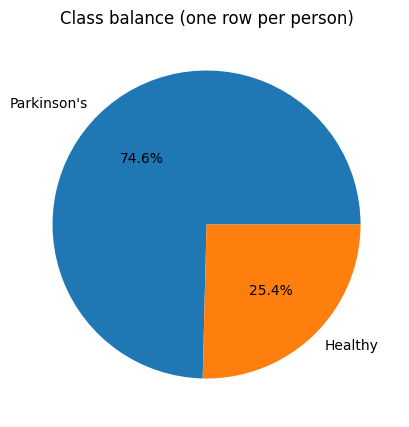
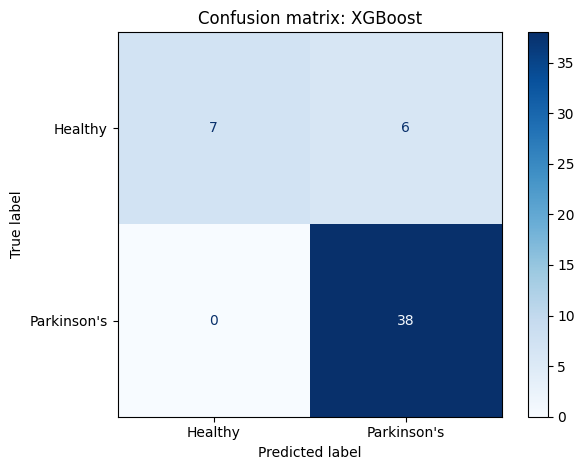

# Parkinson's Disease Prediction from Voice Recordings

Predicts whether a person has **Parkinson's disease** from acoustic features of their voice. Starting from about 750 features, the pipeline removes redundant ones, selects the 30 most informative, and compares Logistic Regression, XGBoost and an SVM.

> **Not medical advice.** This is a learning project trained on a small dataset of 252 people. Its predictions must not be used to diagnose anyone. Anyone concerned about Parkinson's symptoms should see a neurologist.

## What it does

1. Loads the voice dataset (`parkinson_disease.csv`): 756 recordings from 252 people, three per person, each with about 750 acoustic measurements and a `class` label (1 = Parkinson's, 0 = healthy).
2. **Averages each person's three recordings** into a single row. The same person can then never end up in both the training and the test set.
3. Plots the class balance. About three-quarters of the people have Parkinson's.
4. Builds one pipeline, re-fitted on training data every time it is trained:
   1. **Correlation filter:** drops any feature whose absolute correlation with an already-kept feature exceeds 0.7.
   2. **Min-max scaling:** maps every feature to the 0–1 range.
   3. **SelectKBest (chi²):** keeps the 30 features most strongly linked to the diagnosis.
   4. **Random oversampling:** balances the two classes in the training data.
   5. **Classifier:** Logistic Regression (class-balanced), XGBoost, or an RBF-kernel SVM.
5. Scores each model with **5-fold stratified cross-validation** (ROC AUC) on all 252 people.
6. Trains on 80% of people and evaluates on the held-out 20%. Reports training and test ROC AUC, test accuracy and an "always predict Parkinson's" baseline, plus a classification report for the best model.
7. Lists the 30 selected features and plots a confusion matrix.

## Concepts covered

- **High-dimensional, small data** — about 750 features but only 252 people. With so many features, a model can easily find patterns that are pure coincidence. Reducing the features is essential, not optional.
- **One row per person** — the dataset has three recordings per person, and those recordings are very similar. If one recording landed in training and another in testing, the model would partly be recognising the *person* rather than the disease. Averaging per person removes that risk.
- **Removing redundant features** — many acoustic measurements are near-duplicates. Keeping just one feature from each highly correlated group makes the model simpler and more stable. The filter uses the *absolute* correlation, so strongly negative correlations count too.
- **Chi-squared feature selection** — `SelectKBest(chi2)` scores how strongly each feature is linked to the class and keeps the top *k*. Chi² needs non-negative values, which is why min-max scaling comes first.
- **Feature selection must happen inside the pipeline** — chi² looks at the class labels. If it is run on the full dataset before splitting (as the original notebook did), it chooses features partly *because* they separate the test patients. The test score then becomes optimistic. Putting every step in one `imblearn` pipeline means each one is learned from training data only, in every cross-validation fold too.
- **Oversampling after the split** — duplicating minority-class rows is done only on training data, so no copies leak into evaluation.
- **ROC AUC, computed correctly** — ROC AUC measures how well a model *ranks* people with Parkinson's above healthy people: 0.5 is random and 1.0 is perfect. It must be computed from predicted probabilities (`predict_proba`), not from hard 0/1 predictions, which throw the ranking away.
- **Cross-validation for small datasets** — a 20% test set here is only about 51 people, so one lucky or unlucky split can swing the score a lot. Averaging over 5 folds gives a steadier estimate, and the ± value shows how much it varies.
- **Overfitting** — a training ROC AUC of 1.0 with a much lower test score (as XGBoost shows) means the model memorized the training people.

## Project structure

```
main.py      # full pipeline, organized into functions (config, loading and
              # per-person averaging, CorrelationFilter transformer, imblearn
              # pipeline, cross-validation, hold-out evaluation, plotting)
README.md    # this file
```

The code is organized into small, named functions driven by a `PipelineConfig` dataclass: `load_data`, `split_data`, `CorrelationFilter`, `get_models`, `build_pipeline`, `cross_validate`, `evaluate_holdout`, `selected_features`, `plot_class_balance`, `plot_confusion_matrix`. `run_pipeline()` runs them in order.

Settings such as the correlation threshold, the number of features kept, whether to oversample, the test size and the number of folds live in `PipelineConfig`, so you can experiment without touching the pipeline code:

```python
from main import PipelineConfig, run_pipeline

run_pipeline(PipelineConfig(k_best_features=15, correlation_threshold=0.8))
```

## Requirements

```
numpy
pandas
matplotlib
scikit-learn
imbalanced-learn
xgboost
```

Install with:

```bash
pip install numpy pandas matplotlib scikit-learn imbalanced-learn xgboost
```

## How to run

Place `parkinson_disease.csv` in the same directory as `main.py`, then:

```bash
python main.py
```

## Sample output

Running the script prints the dataset size, the cross-validated ROC AUC of each model, a hold-out comparison table with the baseline, a classification report and the 30 selected features, then displays the class balance and a confusion matrix.

**Class balance**



**Confusion matrix (best model)**



**Results from the original notebook (before the fixes)**

| Model | Training score* | Validation score* |
|-------|----------------:|------------------:|
| Logistic Regression | 0.781 | **0.830** |
| XGBoost | 1.000 | 0.647 |
| SVM (RBF) | 0.626 | 0.646 |

\* Labelled "accuracy" in the notebook, but actually ROC AUC calculated from hard 0/1 predictions.

## A note on the results

The original notebook's numbers are hard to trust, for four reasons:

- **Feature selection leaked.** The correlation filter and chi² selection ran on all 252 people before the split. Chi² uses the labels, so the 30 features were partly chosen by looking at the validation patients.
- **"Accuracy" was really ROC AUC from 0/1 predictions.** That throws away the model's confidence and gives a coarse, misleading score.
- **The correlation filter loop had bugs.** It removed items from the list it was looping over, which silently skips columns. It also ignored strong *negative* correlations.
- **The validation set was only about 51 people.** Logistic Regression scoring *higher* on validation (0.83) than on training (0.78) is a sign of how much a single small split can vary.

There is also a scaling issue: the original models were trained on unscaled features, which particularly hurts the SVM. This version feeds them the min-max-scaled features.

All of this is fixed here, and cross-validation is added for a steadier estimate. Expect somewhat lower but more honest scores. Rerun the script and add your numbers to the table above.

Natural next steps would be:

- tuning `k_best_features` and each model's hyperparameters with nested cross-validation;
- trying other feature-selection methods (mutual information, L1-regularized models);
- reporting sensitivity and specificity, which are the standard measures in medical screening.

## References

- [UCI Machine Learning Repository — Parkinson's Disease Classification](https://archive.ics.uci.edu/dataset/470/parkinson+s+disease+classification)
- [scikit-learn — Feature selection](https://scikit-learn.org/stable/modules/feature_selection.html)
- [imbalanced-learn — Common pitfalls and data leakage](https://imbalanced-learn.org/stable/common_pitfalls.html)
- [GeeksforGeeks — Machine Learning Projects](https://www.geeksforgeeks.org/machine-learning/machine-learning-projects/), used as a general reference/inspiration while working on this project.

---
*This is a personal learning project. It is not a medical device and must not be used for diagnosis.*
