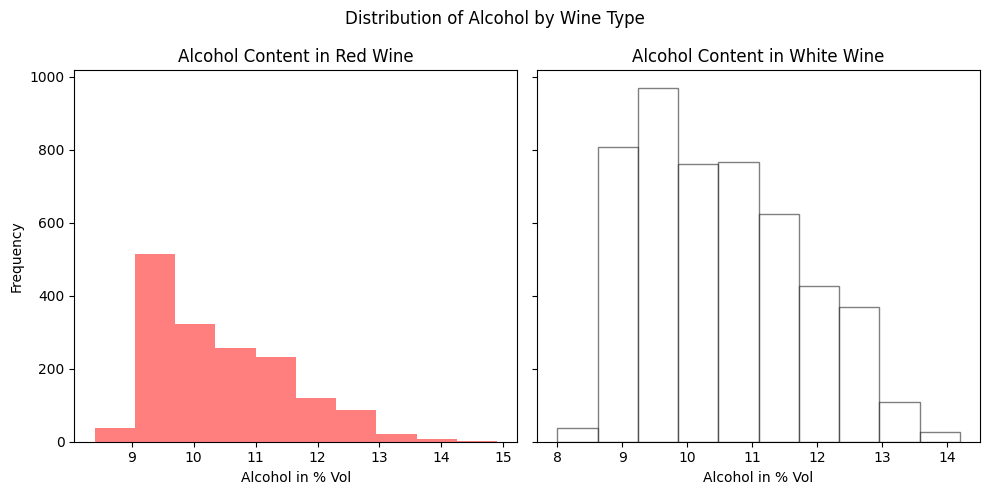
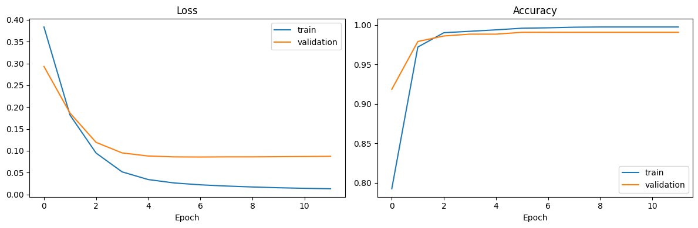
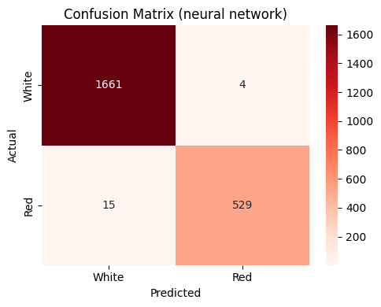

# Wine Type Classification with a Neural Network

Predicts whether a wine is **red or white** from its chemical measurements, using a small Keras neural network on the [UCI Wine Quality dataset](https://archive.ics.uci.edu/dataset/186/wine+quality). A Logistic Regression model serves as a baseline for comparison.

## What it does

1. Loads the red (1,599) and white (4,898) wine data from the UCI repository, or from local copies, and labels each wine: `type` = 1 for red, 0 for white.
2. Plots the distribution of alcohol content for red and white wines.
3. Uses 12 features: fixed acidity, volatile acidity, citric acid, residual sugar, chlorides, free and total sulphur dioxide, density, pH, sulphates, alcohol and the quality score.
4. Splits the data into 66% training and 34% test, **stratified** so both keep the same red/white ratio.
5. **Standardizes** the features, using statistics from the training set only.
6. Trains a feed-forward neural network (12 → 9 → 1 neurons, ReLU hidden layers, sigmoid output). It holds back 10% of the training data for validation and uses **early stopping**.
7. Trains a **Logistic Regression** baseline on the same data.
8. Evaluates both on the **test set**: accuracy next to an "always predict white" baseline, a classification report, and a confusion matrix.
9. Shows the first 12 test predictions alongside the true wine type, plus training/validation loss and accuracy curves.

## Concepts covered

- **Binary classification with a neural network** — the network outputs one number between 0 and 1 (sigmoid). Values of 0.5 and above are classified as red. It is trained with **binary cross-entropy** loss and the **Adam** optimizer.
- **Feature scaling for neural networks** — the raw features range from about 0.01 (chlorides) to about 300 (total sulphur dioxide). Unscaled, the large features dominate the first layer's weighted sums and training becomes slow and unstable. Standardizing gives each feature mean 0 and standard deviation 1.
- **Training vs. test performance** — accuracy shown *during* training measures how well the model fits data it has already seen. Only accuracy on a held-out test set shows how it will do on new wines.
- **Validation split and early stopping** — part of the training data is set aside to monitor the model after every epoch. Training stops automatically when validation loss stops improving, and the best weights are restored. That avoids guessing the right number of epochs and limits overfitting.
- **Batch size** — the original notebook used `batch_size=1`, which updates the weights after every single wine. That is slow and noisy. A batch size of 32 is a standard default: faster, with smoother updates.
- **Baselines**
  - *Majority class:* about 75% of the wines are white, so a model that always says "white" is already about 75% accurate. Anything useful must clearly beat that.
  - *A simpler model:* Logistic Regression checks whether a neural network is needed at all. If a linear model does just as well, it is the better choice: faster, simpler and easier to explain.
- **Reproducibility** — `keras.utils.set_random_seed` fixes the random weight initialization and data shuffling, so repeated runs give the same result.

## Project structure

```
main.py      # full pipeline, organized into functions (config, loading,
              # stratified split, scaling, Keras network with early stopping,
              # Logistic Regression baseline, evaluation, plotting)
README.md    # this file
```

The code is organized into small, named functions driven by a `PipelineConfig` dataclass: `load_data`, `split_data`, `scale_features`, `build_network`, `train_network`, `train_baseline`, `evaluate`, `show_sample_predictions`, `plot_alcohol_by_type`, `plot_training_history`, `plot_confusion_matrix`. `run_pipeline()` runs them in order.

Settings such as the data location, network size, epochs, batch size and early-stopping patience live in `PipelineConfig`, so you can experiment without touching the pipeline code:

```python
from main import PipelineConfig, run_pipeline

run_pipeline(PipelineConfig(hidden_units=[32, 16], epochs=100))

# use local copies of the data instead of downloading
run_pipeline(PipelineConfig(red_path="winequality-red.csv", white_path="winequality-white.csv"))
```

## Requirements

```
numpy
pandas
matplotlib
seaborn
scikit-learn
tensorflow
```

Install with:

```bash
pip install numpy pandas matplotlib seaborn scikit-learn tensorflow
```

`tensorflow` provides Keras and its default backend. Keras 3 can also run on JAX or PyTorch. Set the `KERAS_BACKEND` environment variable if you prefer one of those.

## How to run

```bash
python main.py
```

The data is downloaded from the UCI repository on each run, so an internet connection is needed. To work offline, download the two CSV files once and point `red_path` and `white_path` at them.

## Sample output

Running the script prints the dataset size, the number of epochs trained, a test-accuracy table with both baselines, a classification report and the first 12 test predictions, then displays the charts.

**Alcohol content by wine type**



**Training and validation curves**



**Confusion matrix**



**Test-set accuracy**

| Model | Test accuracy |
|-------|--------------:|
| Neural network | _run to fill in_ |
| Logistic Regression | _run to fill in_ |
| Always predict "white" | ≈ 0.75 |

## A note on the results

The original notebook reported **95.5% accuracy**, but that figure came from the progress bar during the third training epoch. It measured the model on the training data and was never checked on the test set. The test predictions were printed but never compared with the true labels. This version evaluates properly on the held-out test set.

Telling red from white wine turns out to be an easy task for these features. Red wines have much less sulphur dioxide and residual sugar, and more volatile acidity and chlorides. Expect well above 95% test accuracy once the features are scaled. On data like this, Logistic Regression usually performs about as well as the neural network. That is a useful lesson in itself: a neural network isn't automatically better, and a simple linear model is often enough when the classes are well separated.

Natural next steps would be:

- predicting wine **quality** (a harder, multi-class problem);
- looking at which features the models rely on most;
- trying cross-validation instead of a single split.

## References

- [UCI Machine Learning Repository — Wine Quality](https://archive.ics.uci.edu/dataset/186/wine+quality)
- [Keras — Sequential model guide](https://keras.io/guides/sequential_model/)
- [Keras — EarlyStopping](https://keras.io/api/callbacks/early_stopping/)
- [GeeksforGeeks — Machine Learning Projects](https://www.geeksforgeeks.org/machine-learning/machine-learning-projects/), used as a general reference/inspiration while working on this project.

---
*This is a personal learning project for practising neural networks with Keras.*
